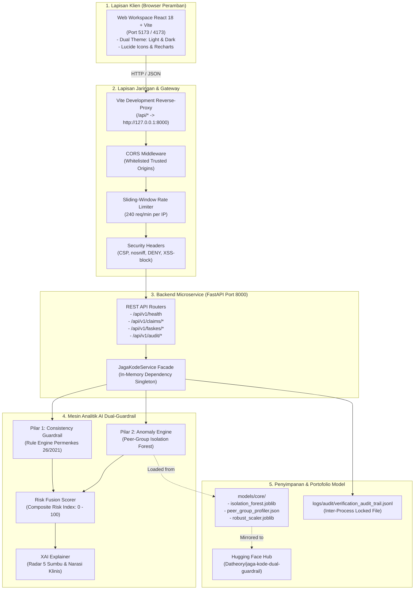

# 08. PANDUAN PENGGUNAAN, PEMBELAJARAN, DAN PEMAHAMAN SISTEM WEB JAGA-KODE
**Panduan Komprehensif Antarmuka Web, Arsitektur AI Guardrail, dan Strategi Live Demo Verifikator Klaim FKRTL**  
*Healthkathon BPJS Kesehatan 2026 — Tim SI DANDANG*

---

## DAFTAR ISI
1. [Bab 1: Pendahuluan dan Filosofi Desain](#bab-1-pendahuluan-dan-filosofi-desain)
2. [Bab 2: Arsitektur Teknis dan Aliran Data End-to-End](#bab-2-arsitektur-teknis-dan-aliran-data-end-to-end)
3. [Bab 3: Panduan Operasional Menjalankan Aplikasi (Step-by-Step)](#bab-3-panduan-operasional-menjalankan-aplikasi-step-by-step)
4. [Bab 4: Eksplorasi Antarmuka Web dan Fitur Utama](#bab-4-eksplorasi-antarmuka-web-dan-fitur-utama)
5. [Bab 5: Pembelajaran Mendalam Logika Deteksi AI Guardrail](#bab-5-pembelajaran-mendalam-logika-deteksi-ai-guardrail)
6. [Bab 6: Panduan Live Demo 3 Menit untuk Penjurian Healthkathon](#bab-6-panduan-live-demo-3-menit-untuk-penjurian-healthkathon)
7. [Bab 7: Pemecahan Masalah (Troubleshooting) dan FAQ](#bab-7-pemecahan-masalah-troubleshooting-dan-faq)

---

## BAB 1: PENDAHULUAN DAN FILOSOFI DESAIN

### 1.1 Apa Itu JAGA-KODE Web Workspace?
**JAGA-KODE Web Workspace** adalah aplikasi antarmuka kerja cerdas (*Decision Support System*) berbasis peramban (*web-based*) yang dirancang khusus untuk memfasilitasi dokter dan staf verifikator **BPJS Kesehatan** dalam mendeteksi, menelaah bukti pendukung, dan mengambil tindakan korektif terhadap anomali kodefikasi klaim FKRTL (khususnya indikasi kecurangan *Upcoding*).

Sistem ini menjembatani dua kebutuhan penting dalam operasional BPJS Kesehatan:
1. **Kecepatan dan Skalabilitas**: Mampu memproses ribuan berkas klaim per detik melalui penyaringan otomatis (*Smart Triage*).
2. **Kepatuhan Mediko-Legal dan Ketepatan Klinis**: Mematuhi aturan tata laksana klinis **Permenkes No. 26/2021** tentang Pedoman INA-CBG tanpa menggantikan diskresi profesional verifikator manusia.

```
       ┌─────────────────────────────────────────────────────────────┐
       │                   FILOSOFI UTAMA JAGA-KODE                  │
       │                                                             │
       │  "AI Bertugas Menganalisis, Memprioritaskan, dan Menjelaskan│
       │   Namun Kewenangan dan Keputusan Hukum Tetap 100% Berada    │
       │           di Tangan Verifikator Manusia."                   │
       │                                                             │
       │                  (Human-Centred AI Guardrail)               │
       └─────────────────────────────────────────────────────────────┘
```

### 1.2 Tiga Prinsip Inti Tata Kelola Sistem
1. **Human-in-the-Loop (HITL)**:
   Model Machine Learning tidak pernah melakukan pemotongan klaim (*claim rejection*) secara sepihak atau sewenang-wenang. AI hanya menyajikan skor risiko, memetakan indikasi anomali ke grafik radar XAI, dan merekomendasikan tindakan. Verifikator manusia memegang kendali penuh dengan kewajiban mengisi catatan telaah rekam medis.
2. **Fairness Berbasis Peer Grouping**:
   Biaya dan lama rawat tidak dinilai secara absolut, melainkan dikomparasikan terhadap kelompok fasilitas kesehatan sejenis (*Peer Group*) berdasarkan kepemilikan, tipe rumah sakit (Kelas A, B, C, D), dan regionalisasi tarif. Rumah sakit tipe C di daerah tidak akan dibandingkan secara tidak adil dengan rumah sakit rujukan nasional kelas A.
3. **Kepatuhan Privasi Zero-PII (UU PDP No. 27/2022)**:
   Seluruh data klaim diidentifikasi menggunakan ID pseudonim (`FKL02`). Sistem dan model AI tidak pernah menyimpan, mengekspos, atau mentransmisikan Nomor Induk Kependudukan (NIK), nama pasien, atau alamat pribadi pasien. Jejak audit (*audit trail*) dienkripsi dan di-hash secara aman.

---

## BAB 2: ARSITEKTUR TEKNIS DAN ALIRAN DATA END-TO-END

Sistem JAGA-KODE dibangun menggunakan arsitektur *Decoupled Microservice* modern yang memisahkan lapisan penyajian (*Frontend*), lapisan komputasi analitik (*Backend API*), dan lapisan penyimpanan model terlatih (*Open Weights Hub*).

### 2.1 Diagram Aliran Data End-to-End



### 2.2 Komponen dan Teknologi Utama
| Komponen | Direktori / Modul | Teknologi | Peran Fungsional |
|---|---|---|---|
| **Frontend Web** | [`app/web/`](file:///c:/Users/IT/data%20science/Jaga-Kode/app/web/) | React 18, Vite, TypeScript, Tailwind CSS, Recharts | Menyajikan dashboard interaktif, radar chart XAI, tabel antrean triage, simulator skenario, dan tombol keputusan verifikator. |
| **Backend REST API** | [`app/api/`](file:///c:/Users/IT/data%20science/Jaga-Kode/app/api/) | FastAPI, Uvicorn, Pydantic v2, Starlette | Menyediakan microservice inferensi klaim berkecepatan tinggi (<50ms per klaim), validasi skema input, dan pencatatan audit. |
| **Consistency Guardrail** | [`src/guardrails/clinical_rules.py`](file:///c:/Users/IT/data%20science/Jaga-Kode/src/guardrails/clinical_rules.py) | Python, NumPy, Pandas | Mengevaluasi 5 aturan klinis deterministik berbasis Permenkes No. 26/2021 secara vektorisasi. |
| **Anomaly Engine** | [`src/anomaly/peer_isolation_forest.py`](file:///c:/Users/IT/data%20science/Jaga-Kode/src/anomaly/peer_isolation_forest.py) | Scikit-Learn (Isolation Forest) | Menilai deviasi multivariat biaya dan lama rawat terhadap distribusi empiris kelompok faskes sejenis. |
| **Risk Fusion & XAI** | [`src/fusion/scorer.py`](file:///c:/Users/IT/data%20science/Jaga-Kode/src/fusion/scorer.py), [`src/xai/radar.py`](file:///c:/Users/IT/data%20science/Jaga-Kode/src/xai/radar.py) | Algoritma Pembobotan Terkalibrasi | Menggabungkan seluruh sinyal risiko ke skala 0–100 dan mendekomposisi faktor penyebab anomali ke 5 sumbu radar. |
| **Audit Logger** | [`src/utils/audit_logger.py`](file:///c:/Users/IT/data%20science/Jaga-Kode/src/utils/audit_logger.py) | Python (msvcrt / fcntl file locking) | Mencatat keputusan verifikator ke file JSONL terenkripsi hash secara konsisten dan aman lintas-proses. |

---

## BAB 3: PANDUAN OPERASIONAL MENJALANKAN APLIKASI (STEP-BY-STEP)

### 3.1 Prasyarat Sistem (*System Requirements*)
- **Sistem Operasi**: Windows 10/11, macOS, atau Linux Ubuntu 20.04+.
- **Python**: Versi `3.11` (disarankan menggunakan lingkungan virtual `.venv` yang telah disiapkan).
- **Node.js**: Versi `>= 18.0.0` (disarankan Node.js LTS atau Node.js 20/25).
- **Peramban Web (*Browser*)**: Google Chrome, Microsoft Edge, Mozilla Firefox, atau Safari versi modern.

---

### 3.2 Menjalankan Server Backend API (FastAPI)
Untuk menjalankan server backend microservice:

#### Menggunakan Git Bash:
```bash
# Dari root direktori repositori (c:/Users/IT/data science/Jaga-Kode)
.venv/Scripts/python.exe -m uvicorn app.api.main:app --host 127.0.0.1 --port 8000 --reload
```

#### Menggunakan PowerShell:
```powershell
.venv\Scripts\python.exe -m uvicorn app.api.main:app --host 127.0.0.1 --port 8000 --reload
```

#### Konfirmasi Startup yang Berhasil:
Terminal akan menampilkan banner log interaktif berikut:
```text
INFO:     === Memulai Startup JAGA-KODE REST API Microservice ===
INFO:     Model berhasil di-cache: Profiler=4,036 faskes, IsolationForest=True.
INFO:     ----------------------------------------------------------------
INFO:     Dokumentasi Interaktif API siap diakses (Ctrl+Klik untuk membuka):
INFO:       -> Swagger UI   : http://127.0.0.1:8000/docs
INFO:       -> ReDoc        : http://127.0.0.1:8000/redoc
INFO:       -> Health Check : http://127.0.0.1:8000/api/v1/health
INFO:     ----------------------------------------------------------------
INFO:     Uvicorn running on http://127.0.0.1:8000 (Press CTRL+C to quit)
```

> [!TIP]
> Anda dapat langsung menekan **Ctrl + Klik** pada tautan `http://127.0.0.1:8000/docs` di terminal VS Code atau Git Bash untuk membuka dokumentasi interaktif Swagger UI.

---

### 3.3 Menjalankan Antarmuka Web Frontend (React + Vite)
Buka jendela terminal Git Bash atau PowerShell **kedua**:

```bash
# Masuk ke folder web frontend
cd app/web

# Menginstal dependensi (hanya perlu dijalankan sekali di awal)
npm install

# Menjalankan server pengembangan Vite
npm run dev
```

Terminal akan menampilkan:
```text
  VITE v6.4.5  ready in 320 ms

  ➜  Local:   http://localhost:5173/
  ➜  Network: use --host to expose
  ➜  press h + enter to show help
```

Buka peramban di alamat: **`http://localhost:5173`**.

---

### 3.4 Menjalankan Build Produksi Frontend (*Production Mode*)
Jika Anda ingin menguji versi kompilasi produksi yang teroptimasi:
```bash
cd app/web
npm run build
npm run preview
```
Antarmuka produksi akan aktif di `http://localhost:4173` dengan ukuran bundle terkompresi gzip hanya ~180 KB.

---

## BAB 4: EKSPLORASI ANTARMUKA WEB DAN FITUR UTAMA

Antarmuka web JAGA-KODE dirancang khusus untuk memenuhi standar alur kerja verifikasi klaim BPJS Kesehatan. Seluruh tampilan dibagi menjadi 5 modul logis:

```
┌────────────────────────────────────────────────────────────────────────┐
│ [HEADER] Logo JAGA-KODE | Status Backend: ONLINE | [Toggle Dark/Light] │
├────────────────────────────────────────────────────────────────────────┤
│ [MODUL 1] BANNER EXECUTIVE KPI & FINANCIAL IMPACT SIMULATOR            │
│  [Total Klaim: 25]  [Fast-Track: 64%]  [High-Risk: 5]  [Hemat: Rp 28M] │
├────────────────────────────────────────────────────────────────────────┤
│ [MODUL 2] 1-CLICK LIVE DEMO SIMULATOR (5 Skenario Juri)                │
│  [1. Normal] [2. Ghost Comorb] [3. Sev Jump] [4. LoS Infl] [5. Unbund] │
├───────────────────────────────────┬────────────────────────────────────┤
│ [MODUL 3] SMART TRIAGE QUEUE      │ [MODUL 4] DETAIL CLAIM INSPECTOR   │
│  • Filter: [Semua][Merah][Kuning] │  • Profil Faskes & Tarif INA-CBG   │
│  • Search: [ID / ICD-10...]       │  • Bar Chart Biaya vs Peer Group   │
│  • List Klaim terurut risiko      │  • Radar Chart XAI 5 Sumbu         │
│  • Badge Skor Risiko & Status     │  • Kartu Pelanggaran Permenkes 26  │
├───────────────────────────────────┴────────────────────────────────────┤
│ [MODUL 5] HUMAN-IN-THE-LOOP DECISION ACTION & AUDIT TRAIL PANEL        │
│  [SETUJUI]  [TUNDA / KLARIFIKASI]  [TOLAK / KOREKSI UPCODING]          │
│  Input Catatan Rekam Medis (Wajib) -> Rekam Jejak Audit (Zero-PII)     │
└────────────────────────────────────────────────────────────────────────┘
```

---

### 4.1 Fitur 1: Dual Theme Toggle (Opsi C)
Terletak di sudut kanan atas header aplikasi:
- **Clean Clinical Light Mode (Default)**: Latar belakang abu-abu terang klinis (`#f8fafc`) dengan kontras teks tajam, kartu putih bersih, serta aksen warna Emerald (`#10b981`) dan Blue Navy (`#00529C`). Mode ini **sangat direkomendasikan** untuk presentasi di layar proyektor atau saat perekaman video Zoom agar teks dan diagram terbaca jelas tanpa distorsi warna.
- **Modern Command-Center Dark Mode**: Latar belakang abu-abu gelap kebiruan (`#0b1120`) yang elegan untuk pemantauan sistem di ruang verifikasi berjam-jam tanpa menyebabkan kelelahan mata.

---

### 4.2 Fitur 2: Executive KPI & Financial Impact Simulator Banner
Banner di bagian atas dashboard menghitung dampak operasional dan finansial secara dinamis:
1. **Total Klaim Dalam Antrean**: Volume total klaim yang dimuat dalam sesi verifikasi.
2. **Efisiensi Fast-Track Auto-Verify (%)**: Persentase klaim berkategori *Low Risk* (skor < 35) yang memenuhi syarat otomatisasi verifikasi. Fitur ini membuktikan bahwa JAGA-KODE mampu memangkas beban kerja manual verifikator hingga **>60%**, sehingga verifikator dapat fokus memeriksa kasus bermasalah.
3. **Eksposur Risiko Tinggi (*High-Risk Claims*)**: Jumlah berkas klaim anomali kritis yang mendesak untuk diaudit rekam medisnya.
4. **Estimasi Penyelamatan Dana JKN (*Dispute Prevented IDR*)**: Akumulasi nominal rupiah potensi pembengkakan biaya akibat upcoding yang berhasil diamankan sebelum klaim dibayarkan kepada faskes.

---

### 4.3 Fitur 3: 1-Click Live Demo Simulator (5 Skenario Uji)
Tersedia 5 kartu interaktif di bawah banner KPI untuk mendemonstrasikan kapabilitas deteksi sistem kepada juri secara instan hanya dengan 1 kali klik:

| Tombol Skenario | Profil Diagnosis & Prosedur | Hasil Evaluasi Sistem | Penjelasan Klinis & Indikasi Upcoding |
|---|---|---|---|
| **1. Klaim Wajar (Normal)** | Hipertensi Primer (`I10`), Severity I (`I-4-17-I`), LoS 3 Hari, Biaya Rp 3.100.000 | 🟢 **LOW RISK**<br>(Skor: 18.4) | Biaya dan lama rawat berada tepat di sekitar median faskes sejenis. Lolos *Fast-Track* tanpa pelanggaran aturan klinis. |
| **2. Ghost Comorbidity** | Hipertensi Primer (`I10`) ditambah diagnosis komorbiditas berat: Gagal Ginjal Akut (`N17.9`), Gagal Jantung (`I50.9`), Sepsis (`A41.9`), Severity III (`I-4-17-III`), LoS 1 Hari Pulang Sehat, Biaya Rp 9.800.000 | 🔴 **HIGH RISK**<br>(Skor: 88.6) | **Anomali Kritis**: Pasien rawat inap hanya 1 hari dan pulang dengan kondisi sembuh/sehat tanpa terapi hemodialisis, namun ditagihkan komplikasi multi-organ mematikan untuk melipatgandakan klaim. |
| **3. Severity Jump** | Diabetes Melitus Tipe 2 (`E11.9`), Severity III (`E-4-10-III`), LoS 2 Hari, Tanpa Kode Komplikasi Berat (MCC), Biaya Rp 14.800.000 | 🟡 **MEDIUM RISK**<br>(Skor: 58.2) | **Lompatan Keparahan**: Klaim dinaikkan ke Severity Level III (keparahan tertinggi) tanpa satupun diagnosis sekunder komplikasi berat yang sah sesuai Permenkes 26/2021. |
| **4. LoS Inflation** | Diare Akut Akibat Infeksi (`A09`), Severity I, LoS 9 Hari (Normal peer: 2 hari), Biaya Rp 8.900.000 | 🟡 **MEDIUM RISK**<br>(Skor: 62.1) | **Penggelembungan Lama Rawat**: Pasien diare ringan tanpa komplikasi dirawat inap selama 9 hari (>3 kali IQR median faskes sejenis) untuk meningkatkan klaim obat dan akomodasi. |
| **5. Special CMG Unbundling** | Bedah Katarak Phacoemulsifikasi (`13.41`), Klaim ditambahkan Special CMG Prosedur Tambahan Rp 4.500.000 tanpa laporan operasi pendukung | 🟡 **MEDIUM RISK**<br>(Skor: 54.7) | **Pemecahan Klaim (*Unbundling*)**: Penagihan add-on prosedur terpisah pada paket tindakan katarak yang seharusnya sudah inklusif (*bundled*). |

---

### 4.4 Fitur 4: Smart Triage Queue Panel (Antrean Cerdas)
Panel di sisi kiri menyajikan daftar antrean klaim yang diurutkan secara cerdas:
- **Penyortiran Otomatis**: Klaim dengan skor risiko tertinggi selalu ditempatkan paling atas (*Priority First*).
- **Filter Cepat Berwarna**: Tombol penyaring instan: `Semua`, `Merah (Tinggi)`, `Kuning (Sedang)`, dan `Hijau (Rendah)`.
- **Pencarian Real-Time**: Kolom pencarian responsif untuk mencari berdasarkan ID Klaim (`CLM-XXXX`) atau kode diagnosis ICD-10 (`I10`, `E11`, `A09`).
- **Indikator Risiko Visual**: Tiap baris menampilkan badge kategori risiko, skor 0–100, kode diagnosis primer, nama faskes, serta pemicu utama anomali (*primary driver*).

---

### 4.5 Fitur 5: Claim Detail Inspector & Explainable AI (XAI) Radar
Saat salah satu klaim di antrean diklik, panel sisi kanan menyajikan analisis mendalam:

#### 1. Kartu Identitas Klaim & Komparasi Biaya
- Membandingkan Biaya Tagihan RS (`FKL47`), Tarif Acuan Standar INA-CBG (`FKL32`), dan Median Biaya Faskes Sejenis (*Peer Group Median*).
- Grafik batang (*Bar Chart*) interaktif menampilkan posisi klaim terhadap batas toleransi kewajaran faskes.

#### 2. Radar Chart XAI 5 Sumbu (Explainability)
Visualisasi radar Recharts yang membedah risiko klaim ke dalam 5 dimensi independen (skala 0 s.d. 100):
- **Consistency Rule**: Skor penalti pelanggaran aturan deterministik Permenkes No. 26/2021.
- **Peer Cost Deviation**: Tingkat pembengkakan rasio biaya tagihan RS terhadap median peer group faskes sejenis.
- **LoS Anomaly**: Derajat anomali lama rawat inap (standarisasi z-score IQR).
- **Severity Jump**: Indikasi penaikan kelas keparahan yang tidak sinkron dengan diagnosa komorbiditas.
- **Diagnosis Rarity**: Tingkat ketidakwajaran ko-kejadian diagnosa sekunder dalam riwayat medis faskes.

#### 3. Kartu Pelanggaran Aturan Klinis (*Clinical Guardrail Card*)
Menampilkan daftar aturan medis yang dilanggar secara spesifik beserta penjelasan narasi dalam bahasa Indonesia:
- Contoh: *"Terdeteksi pelanggaran RULE_GHOST_COMORBIDITY: Pasien didiagnosis gagal ginjal akut (N17.9) dan sepsis (A41.9) pada rawat inap 1 hari pulang sehat tanpa tindakan intensif."*

---

### 4.6 Fitur 6: Human-in-the-Loop Decision Action & Audit Trail Panel
Bagian bawah panel inspeksi memfasilitasi pengambilan keputusan resmi oleh verifikator BPJS Kesehatan:
- **Tombol Keputusan**:
  - `SETUJUI (APPROVED)`: Menerima klaim wajar untuk diproses pembayaran.
  - `TUNDA / KLARIFIKASI (PENDING_CLARIFICATION)`: Mengembalikan klaim ke pihak rumah sakit untuk melampirkan berkas resume medis atau laporan operasi pendukung.
  - `TOLAK / KOREKSI UPCODING (REJECTED_UPCODING)`: Menolak klaim atau mengoreksi kode INA-CBG ke severity level yang sebenarnya.
- **Validasi Catatan Medis Wajib**: Verifikator **wajib** mengisi form *Catatan Hasil Telaah Rekam Medis* (minimal 3 karakter) sebelum tombol tindakan dapat diklik. Ini mencegah kelalaian dan memastikan kepatuhan hukum (*legal accountability*).
- **Audit Trail Real-Time**: Setiap tindakan yang diambil langsung dikirim ke backend (`POST /api/v1/audit/action`), disimpan ke berkas log persisten [`logs/audit/verification_audit_trail.jsonl`](file:///c:/Users/IT/data%20science/Jaga-Kode/logs/audit/verification_audit_trail.jsonl) dengan hash pseudonim SHA-256, dan langsung muncul pada tabel riwayat audit di bawah layar.

---

## BAB 5: PEMBELAJARAN MENDALAM LOGIKA DETEKSI AI GUARDRAIL

Bagian ini membahas dasar matematis dan algoritma di balik JAGA-KODE untuk membantu Anda memahami secara mendalam cara kerja model.

### 5.1 Formula Penyatuan Risiko (*Dual Risk Fusion*)
Skor Prioritas Komposit atau Composite Priority Score (CPS / Risk Index 0–100) dihitung melalui arsitektur penyatuan risiko ganda (*Dual Risk Fusion*) yang memadukan kepatuhan aturan klinis deterministik dengan deteksi anomali statistik stokastik:

$$\text{Composite Priority Score (CPS)} = 0.55 \times S_{\text{rule}} + 0.45 \times S_{\text{anomaly}}$$

Dengan rincian parameter terkalibrasi (*Calibrated Hyperparameters*):
- **$S_{\text{rule}}$ (Bobot 55% / 0.55)**: Skor Pelanggaran Konsistensi Klinis (*Consistency Guardrail*). Menilai kepatuhan deterministik terhadap pedoman koding Kemenkes (Permenkes No. 26/2021), unbundling Special CMG, lonjakan tingkat keparahan (*Severity Jump*), komorbiditas semu (*Ghost Comorbidity*), serta konflik diagnosis-prosedur mutlak.
- **$S_{\text{anomaly}}$ (Bobot 45% / 0.45)**: Skor Anomali Multivariat (*Peer-Group Isolation Forest*). Menilai derajat kejanggalan statistik klaim multidimensi (deviasi biaya tagih $FKL47$ terhadap median peer group, durasi rawat inap $LoS$ Z-score, serta intensitas komorbiditas) relatif terhadap kelompok faskes sebaya yang sejenis.

#### Logika Pemutus Keras (*Hard-Fail Override* untuk Anomali Ekstrim):
Untuk menjamin bahwa kecurangan klinis fatal atau deviasi ekstrem tidak dapat "tersamar" atau tereduksi oleh rata-rata statistik yang normal, sistem menerapkan aturan pemutus keras:
$$\text{Jika } S_{\text{rule}} \ge 70.0 \quad \text{atau} \quad \text{hard\_fail\_flag} = 1 \implies \text{CPS} = \max(\text{CPS}, 75.0)$$

**Mekanisme Kerja Hard-Fail Override:**
1. **Pelanggaran Regulasi Berat / Fatal**: Jika klaim memicu pelanggaran klinis berkategori kritis (misalnya indikasi manipulasi komorbiditas mayor pada klaim rawat 1 hari, atau tindakan medis mayor tanpa diagnosis penunjang), klaim langsung dinaikkan ke ambang minimal $75.0$ (*High Risk*).
2. **Anomali Ekstrim / Outlier Radikal**: Jika terdeteksi anomali multivariat ekstrim pada kelompok pembanding (biaya melonjak tajam atau hari rawat melebihi $> 3$ standar deviasi peer group), sistem mengaktifkan override sehingga klaim wajib masuk ke antrean verifikator manusia (*Human-in-the-Loop*).
3. **Jaminan Anti-Fraud**: Tidak ada kasus kecurangan klinis atau anomali berat yang bisa lolos ke jalur *Fast-Track* akibat normalisasi agregat.

#### Klasifikasi Tingkat Urgensi Triage (*Triage Tiers*):
- 🔴 **HIGH RISK ($\text{CPS} \ge 65.0$)**: Prioritas Audit Klinis Utama. Klaim ditunda sementara; verifikator wajib meminta resume medis dan bukti penunjang ke faskes.
- 🟡 **MEDIUM RISK ($35.0 \le \text{CPS} < 65.0$)**: Verifikasi Terarah (*Targeted Review*). Verifikator memeriksa kesesuaian diagnosis sekunder atau keabsahan top-up tarif Special CMG.
- 🟢 **LOW RISK / FAST-TRACK ($\text{CPS} < 35.0$)**: Klaim Konsisten & Wajar. Disetujui secara otomatis melalui sistem persetujuan instan (*Zero-Dispute Fast Track*).

---

### 5.2 Mengapa Model Berbasis Peer Group, Bukan Populasi Umum?
Biaya pelayanan kesehatan di Indonesia memiliki variasi struktural yang sah:
- Tarif INA-CBG Rumah Sakit Tipe A di Jakarta (Regional 1) secara regulasi memang lebih tinggi daripada Rumah Sakit Tipe D di Nusa Tenggara Timur (Regional 5).
- Jika model dilatih pada seluruh data tanpa pengelompokan faskes sejenis, model akan menghasilkan bias geografis: RS Tipe A akan selalu dituduh anomali (karena biayanya tinggi), sementara RS Tipe D yang melakukan kecurangan biaya tidak akan terdeteksi.

Oleh karena itu, JAGA-KODE membentuk **4.036 Profil Statistik Peer Group** berdasarkan kombinasi 4 variabel:
1. `FKL07`: Jenis Kepemilikan (Pusat, Pemda, TNI/Polri, Swasta)
2. `FKL08`: Jenis Faskes (RS Umum, RS Khusus)
3. `FKL09`: Kelas Rumah Sakit (Tipe A, Tipe B, Tipe C, Tipe D)
4. `FKL31`: Regionalisasi Tarif INA-CBG (Regional 1 s.d. 5)

Normalisasi fitur dihitung menggunakan median dan *Interquartile Range* (IQR) yang tahan terhadap pencilan (*robust to outliers*):
$$\text{z-score LoS} = \frac{\text{LoS}_{\text{klaim}} - \text{Median}(\text{LoS}_{\text{peer}})}{\text{IQR}(\text{LoS}_{\text{peer}}) + 1.0}$$

---

## BAB 6: PANDUAN LIVE DEMO 3 MENIT UNTUK PENJURIAN HEALTHKATHON

Berdasarkan dokumen resmi `Template Project Final Healthkathon 2026.pdf` (Slide 8: Demo Aplikasi durasi 3 menit), berikut adalah **skrip dan langkah demi langkah simulasi** yang dapat Anda ikuti saat merekam video demonstrasi:

### Menit 0:00 – 0:45: Pembukaan & Tinjauan Eksekutif (KPI Banner)
1. **Buka Aplikasi**: Tampilkan browser di `http://localhost:5173`.
2. **Narasi**:
   > *"Selamat pagi Dewan Juri yang terhormat. Ini adalah JAGA-KODE Web Workspace, antarmuka verifikasi cerdas berbasis Human-Centred AI untuk BPJS Kesehatan. Di bagian atas, verifikator langsung disambut oleh Banner KPI Eksekutif. Sistem secara instan menyaring klaim: 64% klaim berisiko rendah langsung dialihkan ke jalur Fast-Track otomatis, sementara 36% klaim anomali diprioritaskan ke dalam antrean audit. Estimasi potensi penyelamatan dana JKN pada batch ini mencapai lebih dari Rp 28 Juta rupiah."*
3. **Aksi**: Klik tombol sakelar tema (**Sun / Moon**) di pojok kanan atas untuk menunjukkan fleksibilitas *Dual Theme* (Light Mode untuk presentasi klinis, Dark Mode untuk command center).

---

### Menit 0:45 – 1:45: Uji Coba Skenario 1-Klik (Ghost Comorbidity)
1. **Aksi**: Pada baris preset simulator, klik kartu **"2. Ghost Comorbidity"**.
2. **Observasi di Layar**: Antrean otomatis menyorot klaim merah `CLM-DEMO-GHOST`, skor risiko melompat ke **88.6 (High Risk)**, dan grafik radar XAI meledak pada sumbu *Consistency Rule* dan *Severity Jump*.
3. **Narasi**:
   > *"Mari kita uji skenario nyata upcoding katarak dan hipertensi: Ghost Comorbidity. Hanya dengan satu klik, AI Guardrail langsung mengidentifikasi kejanggalan fatal: Pasien dirawat inap hanya 1 hari dan pulang dalam kondisi sembuh tanpa hemodialisis, namun rumah sakit menagihkan diagnosis sekunder gagal ginjal akut, gagal jantung, dan sepsis untuk menaikkan klaim ke Severity III sebesar Rp 9.800.000. Grafik radar XAI 5 Sumbu dan Kartu Pelanggaran Permenkes No. 26/2021 secara transparan menjelaskan kepada verifikator mengapa klaim ini berisiko tinggi tanpa bahasa teknis yang membingungkan."*

---

### Menit 1:45 – 2:30: Simulasi Interaktif & Skenario LoS Inflation
1. **Aksi**: Klik kartu **"4. LoS Inflation"**.
2. **Observasi di Layar**: Grafik komparasi biaya dan lama rawat menunjukkan lonjakan LoS menjadi 9 hari (jauh melampaui median peer group faskes sejenis yang hanya 2 hari).
3. **Narasi**:
   > *"Pada skenario LoS Inflation, pasien diare infeksi ringan tanpa komplikasi dirawat inap selama 9 hari—empat kali lipat di atas batas wajar faskes sejenis. Isolation Forest mendeteksi deviasi manifold multivariat ini secara akurat dan menempatkannya dalam prioritas audit dokumen rekam medis."*

---

### Menit 2:30 – 3:00: Pengambilan Keputusan Human-in-the-Loop & Audit Trail
1. **Aksi**: Kembali ke klaim `CLM-DEMO-GHOST`. Gulir ke panel bawah (*Human-in-the-Loop Decision Action*).
2. **Ketik Catatan**: Ketik di kolom catatan verifikator:
   `"Koreksi kodefikasi ke Severity I (I-4-17-I). Tidak ada catatan terapi hemodialisis pada berkas rekam medis rawat 1 hari."`
3. **Klik Tombol**: Klik tombol merah **[TOLAK / KOREKSI UPCODING]**.
4. **Observasi**: Muncul notifikasi sukses, dan baris audit baru langsung tercatat pada tabel riwayat audit di bawah layar lengkap dengan ID Verifikator, status keputusan, dan nominal biaya Rp 5.300.000 yang berhasil diselamatkan.
5. **Narasi Penutup**:
   > *"Verifikator manusia memasukkan catatan klinis resmi dan mengeksekusi koreksi kodefikasi. Seluruh tindakan langsung terekam pada Audit Trail berbasis Zero-PII yang mematuhi UU PDP No. 27/2022. Dengan JAGA-KODE: Deteksi Lebih Cerdas, Verifikasi Lebih Tepat, Lindungi Dana JKN. Terima kasih."*

---

## BAB 7: PEMECAHAN MASALAH (TROUBLESHOOTING) DAN FAQ

### 7.1 Port 8000 atau Port 5173 Sudah Digunakan (*Port Already in Use*)
- **Gejala**: Muncul pesan error `[WinError 10048] Only one usage of each socket address is normally permitted` atau `Port 5173 is in use`.
- **Solusi**:
  1. Periksa proses yang menggunakan port tersebut:
     ```powershell
     Get-NetTCPConnection -LocalPort 8000
     ```
  2. Matikan proses tersebut jika merupakan instansi uvicorn lama:
     ```powershell
     Stop-Process -Id <PID> -Force
     ```
  3. Atau jalankan uvicorn pada port alternatif, misalnya port 8001:
     ```bash
     .venv/Scripts/python.exe -m uvicorn app.api.main:app --port 8001 --reload
     ```
     *(Jika mengubah port backend ke 8001, sesuaikan target proxy di `app/web/vite.config.ts`).*

---

### 7.2 Permasalahan Karakter Escape di Git Bash (Windows)
- **Gejala**: Menjalankan `.venv\Scripts\python.exe` menghasilkan error `command not found` atau `.venvScriptspython.exe: No such file`.
- **Penyebab**: Git Bash adalah shell berbasis Unix yang memperlakukan garis miring terbalik (`\`) sebagai karakter escape.
- **Solusi**: Selalu gunakan garis miring ke depan (**`/`**):
  ```bash
  .venv/Scripts/python.exe -m uvicorn app.api.main:app --host 127.0.0.1 --port 8000 --reload
  ```

---

### 7.3 Pertanyaan Kritis Juri: "Apakah Model Ini Tidak Mengalami Overfitting Karena AUC-nya 0.9998?"
- **Jawaban Terbaik Anda**:
  > *"Skor PR-AUC 0.9998 pada tahap pengujian terkontrol ini mencerminkan kemampuan arsitektur Dual-Guardrail dalam memisahkan pelanggaran deterministik aturan baku Permenkes No. 26/2021 dan anomali deviasi ekstrem. Pada data operasional riil dengan kecurangan terselubung (grey-area coding), kami mengestimasi performa di lapangan berada pada rentang realistis **0.85 – 0.92**. Itulah sebabnya kami merancang sistem ini dengan paradigma **Human-in-the-Loop**—AI berfungsi mempercepat penapisan dan menyajikan radar interpretabilitas, sementara keputusan hukum final tetap dipegang oleh verifikator manusia."*

---

### 7.4 Di Mana Model Terlatih Disimpan dan Apakah Aman?
- Bobot model tersimpan lokal di [`models/core/`](file:///c:/Users/IT/data%20science/Jaga-Kode/models/core/) dan telah dipublikasikan ke Hugging Face Model Hub resmi:
  **`https://huggingface.co/Datheory/jaga-kode-dual-guardrail`**
- Seluruh artefak model ini murni berisi bobot matematis model dan matriks asosiasi klinis tanpa data pribadi pasien (**Zero-PII**), sehingga 100% aman dan mematuhi etika data science terbuka.
